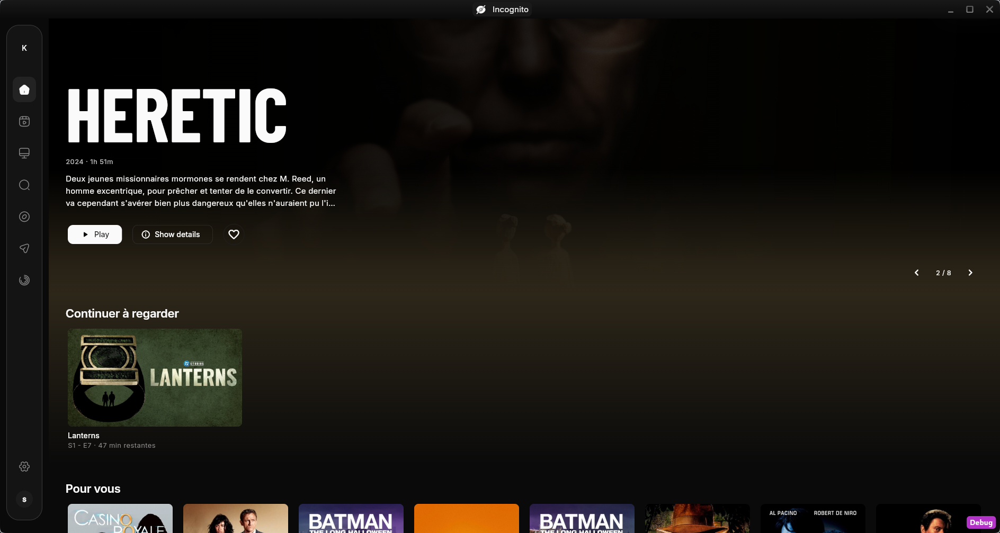
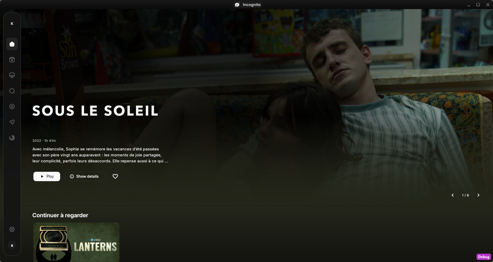
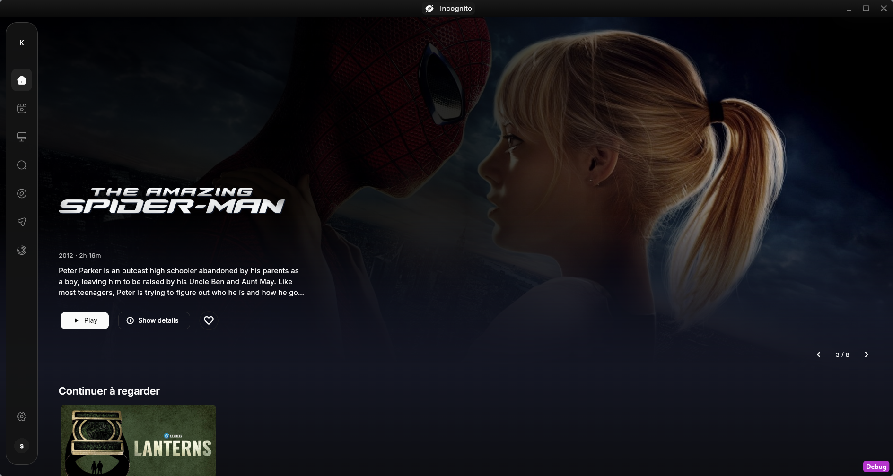
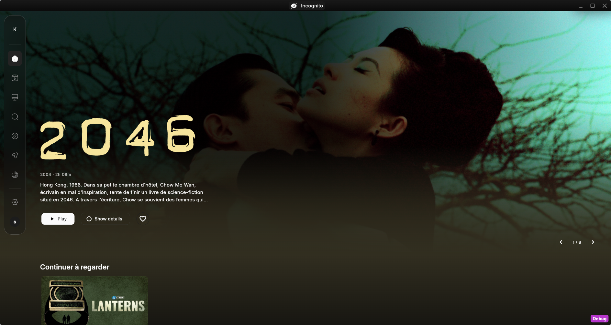
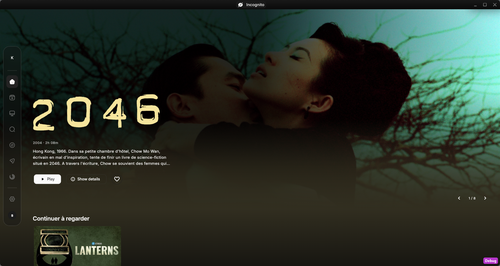
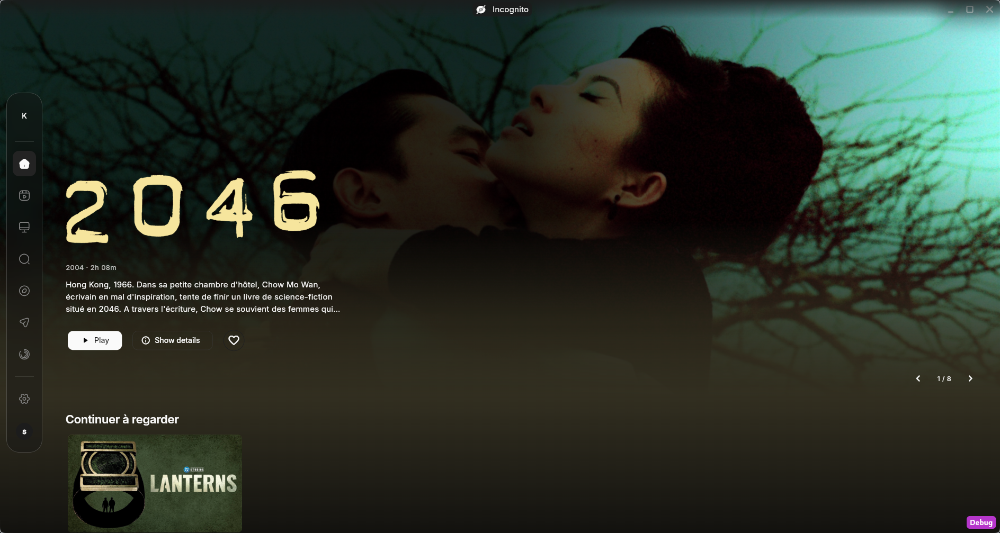

# Kinos — validation de l’intégration UI

27 octobre 2026. Intégration locale autorisée par « lance l’intégration ».

## Périmètre réalisé

- Accueil : titre condensé Barlow Condensed, image cinéma, métadonnées,
  synopsis et actions localisées. Navigation manuelle du carrousel au clavier.
- Teinte issue de la même image que celle affichée, limitée au groupe bandeau
  et reprise. La barre latérale et les rangées suivantes restent neutres.
- Navigation graphite flottante, sélection arrondie, libellés au survol et au
  focus, réglages et unique avatar en bas.
- Images de reprise en 16:9, affiches en 2:3 ; calcul des rangées selon leur
  largeur locale, avec six à huit colonnes aux largeurs desktop couvertes.
- Jetons communs de surfaces, contrôles, menus et dialogues ; titre des fiches
  harmonisé. Contrôles et indicateurs du lecteur restylés sans déplacement de
  ses groupes de boutons.
- Police et licence ajoutées dans `assets/fonts/barlow_condensed/`, déclaration
  dans `pubspec.yaml` et attribution dans `NOTICE`.

Les changements principaux concernent `lib/theme/app_theme.dart`,
`lib/screens/dashboard/`, `side_navigation_bar.dart`,
`media_detail_scaffold.dart` et les styles du lecteur. Les copies avant
intégration des fichiers déjà modifiés sont conservées dans
`/tmp/kinos-ui-baseline/`. Le travail Seerr préexistant a été préservé ; aucun
ajout Git global ni commit d’implémentation n’a été effectué.

## Vérifications exécutées

| Vérification | Résultat |
| --- | --- |
| Suite Flutter complète (`fvm flutter test`) | 661 tests passent |
| Références visuelles de l’accueil | 9 tests passent, 8 images de référence |
| Analyse Flutter (`fvm flutter analyze`) | 37 diagnostics, comme avant intégration |
| Compilation Linux debug (`fvm flutter build linux --debug`) | Réussie |
| `git diff --check` | Réussi |

Les journaux de cette session sont dans `/tmp/kinos-ui-baseline/` :
`tests-proof.log`, `visual-proof.log`, `analyze-proof.log`, `build-proof.log`.
L’analyse ne constitue donc pas un contrôle sans diagnostics : les 37
diagnostics préexistaient, aucun diagnostic supplémentaire ne subsiste.

Les tests dédiés couvrent le parcours directionnel des actions du bandeau,
le titre long et le texte à 150 %, les infobulles clavier, la sélection du
backdrop et les résultats asynchrones périmés de palette, les formats des
images et la largeur locale des rangées. Un fond blanc extrême vérifie le
contraste du texte principal et secondaire sur le voile de l’image.

Les références visuelles couvrent 1280, 1440 et 1920 pixels, texte agrandi,
navigation déployée, densité salon et états vides. Les pixels sous la barre
latérale et après le bandeau sans reprise sont également contrôlés. Les
fixtures utilisent une image illustrative locale, sans accès Jellyfin.

Une revue indépendante a identifié puis fait corriger la priorité du backdrop,
la largeur locale de reprise et les libellés au focus. Elle a aussi contrôlé
que la modification du lecteur ne déplace pas ses commandes.

## Observation dans l’application

Kinos a été relancé avec la compilation locale et les derniers changements
rechargés. L’accueil connecté a été observé dans la fenêtre réelle Linux.

La capture initiale et la capture finale montrent des films différents : elles
ne servent pas de comparaison pixel à pixel. Le badge Debug appartient à
l’exécution de développement.

## Limites de validation

Les maquettes complètes restent une direction visuelle ; chaque écran n’a pas
fait l’objet d’une comparaison manuelle avec sa maquette. Les écrans partagés
héritent du thème, avec une refonte structurelle concentrée sur l’accueil et
la navigation. La disposition du lecteur est vérifiée dans le code ; aucune
session de lecture réelle n’a été lancée pour cette validation. La densité
salon testée ne constitue pas une activation du mode salon de bout en bout.

## Ajustement validé — bandeau et navigation flottante

Le 27 octobre, l’utilisateur a explicitement annulé la règle de fond neutre
sous la navigation. Le bandeau et sa teinte passent désormais jusqu’au bord
gauche ; le fond rectangulaire de la navigation est supprimé, seule sa capsule
garde un matériau graphite translucide. Textes, actions et cartes conservent
leur espace hors capsule. `AGENTS.md`, `CLAUDE.md` et `DESIGN.md` reflètent cette
nouvelle règle ; les consignes antérieures sur ce point sont remplacées.

Le bandeau vise 75 % de la hauteur du viewport, sans descendre sous le minimum
de sa densité ni couper ses actions en texte agrandi. Le cadrage haut préserve
mieux les visages ; un recadrage reste possible selon le format de la source.
Le logo issu de `tvPosterLogo` remplace le titre, avec proportions conservées
et texte de repli pendant le chargement ou en cas d’erreur. Aucun changement
de modèle ou d’appel API supplémentaire depuis les widgets.

Les tests ont d’abord montré les trois comportements manquants (hauteur,
logo et fond sous le rail), puis passent avec l’implémentation. La suite
complète passe à **664 tests** ; les 9 tests visuels passent avec leurs références
actualisées. L’analyse conserve les **37 diagnostics préexistants**. Journaux :
`artwork-red.log`, `artwork-green.log`, `artwork-visual.log`, `artwork-suite.log`,
`artwork-analyze.log`, dans `/tmp/kinos-ui-baseline/`.

Une nouvelle revue indépendante ciblée ne relève aucun défaut bloquant. Le
rechargement de Kinos a permis de constater un vrai logo Jellyfin et le fond
plein cadre. Le lecteur n’est pas modifié par cet ajustement.

## Verre dépoli et correction du raccord

À la demande de l’utilisateur, la capsule utilise un `BackdropFilter` de sigma
18 découpé par son `ClipRRect`, une surface graphite à 65 % et un fin contour
clair. Le filtre ne couvre pas la fenêtre entière. En contraste élevé, il est
désactivé et la surface devient opaque. Aucun flou ajouté au bandeau lui-même.

La ligne sombre est un artefact du bord de calque du `ShaderMask`, visible
sur Linux avec la hauteur fractionnaire du bandeau. Le découpage `ClipRect`
sans anticrénelage élimine le débordement de cette rangée. La capture initiale
montre une baisse de 9 à 14 niveaux RGB à la ligne 790 ; la capture finale
présente un écart nul aux quatre mêmes abscisses (200, 800, 1400, 1800).
Les films des deux captures diffèrent : la mesure porte sur la rupture locale
entre les lignes adjacentes, pas sur leur couleur absolue.

Le test de diffusion utilise un vrai rail devant des bandes noires/blanches :
il échoue avec le matériau précédent, puis passe avec le flou et la transparence.
Le test logiciel de bord fractionnaire ne reproduit pas le défaut GPU natif ;
il contrôle néanmoins la continuité du fondu. La preuve de disparition de la
ligne provient de la capture Linux, pas d’un test logiciel initialement rouge.

La revue indépendante de ces deux changements ne relève pas de bug matériel.
Les captures de référence ont été actualisées ; journaux dédiés préfixés
`glass-` dans `/tmp/kinos-ui-baseline/`.

Vérification finale : **666 tests passent**, analyse toujours à **37 diagnostics
préexistants**, compilation Linux debug réussie et `git diff --check` réussi.

À la demande suivante de l’utilisateur, l’opacité graphite passe de 65 % à
40 % pour rendre le verre plus transparent ; flou et bordure sont conservés.
Les 11 tests navigation/visuels passent, leurs références sont actualisées,
la compilation Linux réussit et Kinos est relancé avec ce réglage.

## Capsule compacte

La capsule s’ajuste désormais à son contenu plutôt qu’à toute la hauteur de la
fenêtre. Deux séparateurs structurent le groupe : après le logo provisoire,
puis après Arr. Réglages et profil suivent directement. La zone centrale reste
défilable si la hauteur disponible est insuffisante, avec accès directionnel
vérifié jusqu’à Arr et au profil dans une hauteur de 400 pixels à texte 150 %.

La suite complète passe à **667 tests** ; les 3 tests ciblés de navigation et
les 9 tests visuels passent. L’analyse reste à **37 diagnostics préexistants**,
la compilation Linux debug réussit. Kinos a été relancé et observé avec cette
barre. Journaux préfixés `compact-rail-` dans `/tmp/kinos-ui-baseline/`.

La capsule est ensuite centrée verticalement à la demande de l’utilisateur.
Le test de centrage échoue avant la modification puis passe après ; les
12 tests navigation/visuels passent avec références actualisées. Flutter a été
rattaché au service VM de l’instance existante et a rechargé les changements
à chaud : aucune fermeture ni relance de Kinos pour cet ajustement. Ce mode
est conservé pour les retouches suivantes, conformément à la préférence utilisateur.

## Bannière sous la barre de titre

La bande noire supérieure venait de l’espace réservé par
`DefaultSliverTopBadding`, et non d’un aplat opaque dans la barre de titre.
Cet espace est omis sur l’accueil desktop lorsqu’un bandeau est présent.
Sans bandeau, il reste en place pour protéger les premières rangées. Les
commandes et la zone de déplacement de `DefaultTitleBar` ne sont pas modifiées.

La même fenêtre avec le même film a été observée après rechargement à chaud :
l’image atteint maintenant le bord supérieur, sous le chrome translucide.
Les **667 tests passent**, l’analyse conserve ses **37 diagnostics préexistants**
et `git diff --check` passe. Journaux `titlebar-suite.log` et
`titlebar-analyze.log` dans `/tmp/kinos-ui-baseline/`.

## Voile uniforme sur la largeur

Le dégradé horizontal à 85 % côté texte, qui disparaissait à droite, est
remplacé par un voile uniforme à 65 %. Le voile inférieur et le fondu vertical
sont conservés. Le paramètre de largeur du voile est supprimé du backdrop et
de son appelant : il ne correspond plus à un comportement du composant.

Le test sur fond blanc détecte d’abord la différence entre les côtés, puis
vérifie leur égalité ainsi que le contraste principal et secondaire ≥ 4,5:1.
Les 9 tests visuels et les **667 tests de la suite complète passent** ; analyse
inchangée à **37 diagnostics préexistants** et formatage vérifié. Rendu observé
dans Kinos après rechargement à chaud, sans redémarrage. Journaux préfixés
`even-scrim-` dans `/tmp/kinos-ui-baseline/`.
